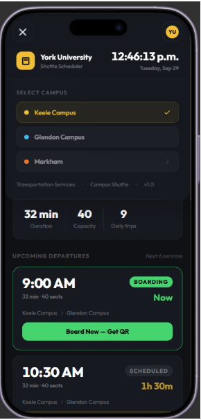
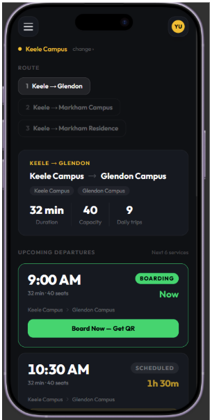
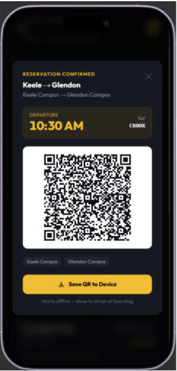

# Architecture

## Context

This document outlines the architecture of Shuttle Bus Visualizer that is a mobile-optimized application designed to help York University students travel between the Keele, Markham, and Glendon campuses. The application addresses difficulties with understanding shuttle schedules, reserving seats, locating departure information, and accessing boarding QR codes when internet connectivity is unreliable.

The system will prioritize a simple, accessible, and user-friendly interface that allows students to find upcoming departures and manage their reservations quickly. The initial version will focus on the core features required for the minimum viable product (MVP).

The primary users are York University students, while shuttle bus drivers and university administrators are secondary stakeholders. The application will be developed using an Agile Scrum approach, with iterative prototyping and feedback throughout development.

## Content

The proposed architecture consists of the following components:

### 1. User Interface (Frontend)
- Built using HTML, CSS, and JavaScript.
- Displays upcoming shuttle departures, destinations, and departure times.
- Provides campus selection for Keele, Markham, and Glendon.
- Includes buttons for booking and cancelling reservations.
- Displays booking confirmations and QR codes in an accessible interface.

### 2. Shuttle Schedule and Availability
- Displays shuttle routes, departure times, and available seats.
- Organizes departures chronologically so students can quickly find suitable buses.
- Uses shuttle schedule and seating-capacity information provided by university administrators.
- Prevents reservations when a shuttle is full.

### 3. Reservation Management

- Allows students to reserve a seat and receive a booking confirmation.
- Allows students to cancel existing reservations.
- Updates seat availability when a reservation is created or cancelled.
- Requires a reliable mechanism to prevent multiple students from reserving the same remaining seat.

### 4. QR Code Generation and Offline Access
- Generates a QR code associated with a confirmed reservation.
- Saves or caches the QR code on the student's device for offline access.
- Allows students to retrieve their boarding confirmation without requiring an active internet connection.
- Requires an appropriate verification mechanism to confirm that QR codes correspond to valid reservations.

### 5. Data Storage and Connectivity

- Stores shuttle schedule information and reservation records.
- Uses an internet connection for booking and cancellation operations.
- Supports offline access to previously saved QR codes.
- Protects student information and limits the collection of personal data.

### 6. Development Tools

- **HTML, CSS, and JavaScript:** Frontend development and prototyping.
- **Figma:** Interface design and wireframes.
- **GitHub:** Version control and collaboration.
- **Visual Studio Code:** Code editing and implementation.
- **Discord and Instagram:** Team communication and coordination.

## Decisions (if any)

- **Development methodology:** Agile Scrum will be used to develop and refine the application through iterative feedback.
- **MVP priorities:** The initial version will focus on shuttle discovery, seat reservations, booking confirmations, and offline QR code access.
- **Interface design:** The application will use a mobile-first layout, clear buttons, readable text, and a chronological display of upcoming departures.
- **Campus selection:** Students will be able to switch between Keele, Markham, and Glendon campuses.
- **Data privacy:** Fictional or sample data will be used during development and testing whenever possible.
- **Offline support:** QR codes will be saved locally so students can access them without a reliable internet connection.
- **Technology choices:** HTML, CSS, JavaScript, Figma, GitHub, and Visual Studio Code will be used for the initial development process.

## Next Steps

- [ ] Create the initial design: Develop Figma wireframes for the homepage, campus selector, shuttle timetable, reservation confirmation, and QR code screen.

- [ ] Build the frontend prototype: Implement the main screens and navigation using HTML, CSS, and JavaScript.

- [ ] Define the data structure: Identify the information needed for shuttle routes, departure times, seating capacity, reservations, and QR codes.

- [ ] Resolve storage and privacy requirements: Decide whether the MVP will use a backend database or a local demonstration using sample data. Document the limitations of the chosen approach.

- [ ] Implement core functionality: Develop shuttle discovery, seat booking, booking cancellation, and QR code generation.

- [ ] Test acceptance criteria: Verify that full buses cannot be overbooked, cancellations release seats, and saved QR codes remain accessible offline.

- [ ] Conduct usability testing: Gather feedback from representative York University students and refine the interface based on their experience.

- [ ] Track progress: Use GitHub to manage code changes and coordinate work through regular team meetings and agreed task assignments.